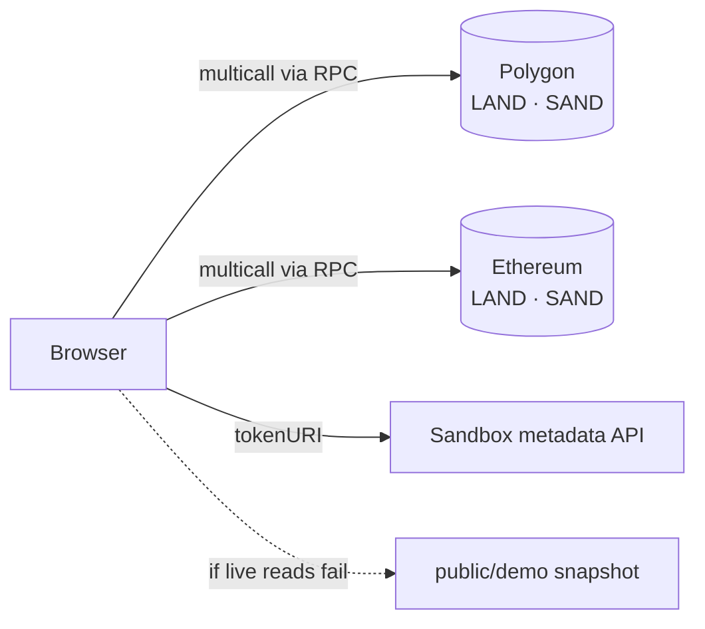

# LAND Explorer

A student demo that explores **The Sandbox** through its public smart contracts: who owns each parcel of land, where it lives (Ethereum or Polygon), and how the SAND token moves. Everything shown is read live from the blockchain. There's no backend, no database and no wallet needed.

> Unofficial student project. Not affiliated with or endorsed by The Sandbox.

## What it shows

| Page | What you see | Blockchain concept |
|---|---|---|
| **Overview** | The three token types, the creator loop, where all 166,464 parcels live | ERC-721 vs ERC-20 vs ERC-1155 |
| **LAND** | Live 408 × 408 map, ownership colours, search, parcel details | ERC-721 ownership and metadata |
| **Economy** | SAND supply on both chains, live transfer feed | ERC-20 supply and `Transfer` events |
| Assets, Mint | Placeholders, not built yet | ERC-1155, writing to a testnet |

## Getting started

Requires **Node.js 22.18 or newer**. The snapshot script runs TypeScript directly in Node.

```bash
npm install
npm run dev
```

Open [http://localhost:3000](http://localhost:3000).

### Optional: your own RPC endpoints

The app works out of the box with free public RPC endpoints, but they can be slow or rate-limited. For a presentation, use your own (free from [Alchemy](https://www.alchemy.com) or [Infura](https://www.infura.io)):

```bash
cp .env.example .env.local
# then fill in:
# NEXT_PUBLIC_POLYGON_RPC_URL=...
# NEXT_PUBLIC_ETHEREUM_RPC_URL=...
```

`.env.local` is git-ignored. These keys are visible in the browser, which is normal for RPC keys; restrict them to your domain in the provider's dashboard.

## Scripts

| Command | What it does |
|---|---|
| `npm run dev` | Start the dev server |
| `npm run build` / `npm start` | Production build / serve it |
| `npm run lint` | ESLint |
| `npm run snapshot` | Save fresh offline data to `public/demo/` (about 1 minute) |

## How it works



- **Direct contract reads.** [wagmi](https://wagmi.sh) and [viem](https://viem.sh) call the contracts from the browser. The visible map window (640 parcels) is read in one batched multicall per chain.
- **Two chains per parcel.** LAND exists on Ethereum and Polygon. A parcel moved to Polygon keeps a copy on Ethereum held by a contract, so **the Polygon owner, when present, is the current owner.**
- **Offline fallback.** If the RPC can't be reached, pages switch to a saved snapshot automatically and show an "Offline" banner. The snapshot covers ownership status for the **whole map** (about 23 KB gzipped), plus full details for the preset parcels.

### Verified contracts

Checked on-chain (name and symbol) on 16 Nov 2026. The Polygon addresses match [The Sandbox's bridge docs](https://docs.sandbox.game/en/owners/tsb-bridge).

| Contract | Network | Address |
|---|---|---|
| LAND | Polygon | `0x9d305a42A3975Ee4c1C57555BeD5919889DCE63F` |
| SAND | Polygon | `0xBbba073C31bF03b8ACf7c28EF0738DeCF3695683` |
| LAND | Ethereum | `0x5CC5B05a8A13E3fBDB0BB9FcCd98D38e50F90c38` |
| SAND | Ethereum | `0x3845badAde8e6dFF049820680d1F14bD3903a5d0` |

### Things learned the hard way

- **LAND token IDs:** `tokenId = x + y × 408`, with raw coordinates 0–407. The map displays them centred, so raw (204, 204) is shown as (0, 0). Verified against token `100000` = LAND (-164, 41).
- **LAND isn't enumerable.** There's no `totalSupply()` or `tokenOfOwnerByIndex()`, so you can't list a wallet's parcels from the contract alone.
- **Multicall batch size matters on Polygon.** With 1,000 `ownerOf` calls per request, every call fails *silently* (reported as "not owned"). The snapshot script uses 250 and re-checks 300 random parcels in small batches before saving.

## Project structure

```
app/
  page.tsx              Overview
  land/                 LAND map, parcel panel, data hooks
  economy/              SAND dashboard, data hooks
  assets/, mint/        Placeholder pages
  icon.svg, apple-icon.tsx
components/
  shell/                Top nav, app shell, side panel
  frame.tsx             Visible page frame, section lines, "+" marks, cell grids
  data-status.tsx       Live / snapshot label, offline banner
lib/
  contracts.ts          Addresses, ABIs, token ID ↔ coordinates
  land.ts               Parcel status rules, search parsing
  wagmi.ts              Chains and RPC config (read-only, no wallet)
scripts/snapshot.mjs    Builds the offline snapshot
public/demo/            Snapshot data and saved preview images
```

## Design

Light, flat and structural: a framed centre column with visible rules and "+" marks, shared-border grids, square corners, large tightly-set headlines and small monospace labels. Type is [Space Grotesk](https://github.com/floriankarsten/space-grotesk) (OFL), icons are [Tabler](https://tabler.io/icons) (MIT). Hover animations respect the system's "reduce motion" setting.

## Known limitations

- **ESTATES** (merged parcels) aren't shown yet.
- The map assumes **y increases downward**; not yet checked against The Sandbox's own map.
- Some preview images are missing upstream (for example, LAND #100000 returns 404).
- The explanatory text on SAND uses and the creator loop is simplified; check it against [The Sandbox's docs](https://docs.sandbox.game) before relying on it.

## Before presenting

1. Run `npm run snapshot` the day before.
2. Add your own RPC keys in `.env.local`.
3. Test the offline fallback once by turning Wi-Fi off.
